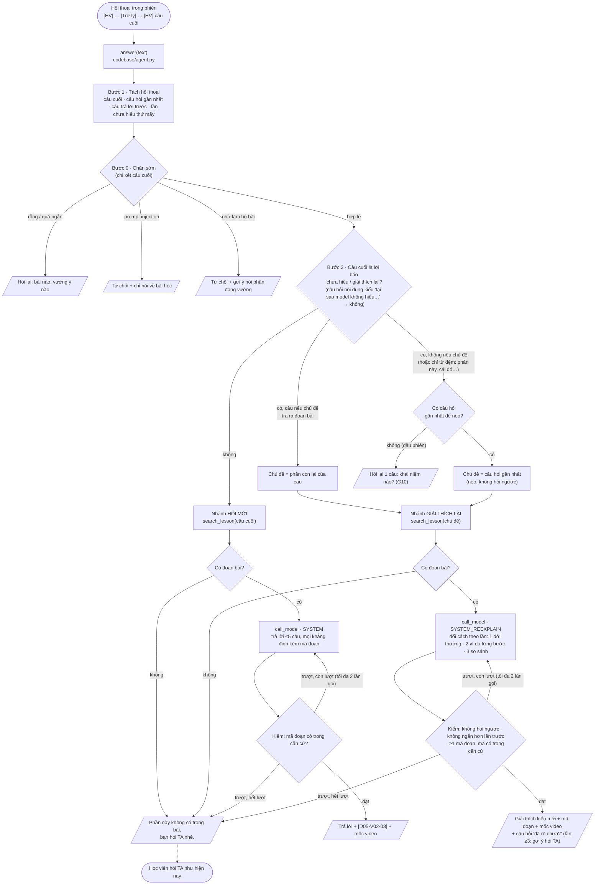

# AI SPEC — Giải thích lại khi học viên "vẫn chưa hiểu" · Nhóm 419 · Phòng [XXX] · Zone [X]

> Mốc nộp: §7 chốt chuẩn "đạt" tại **CP2 19:30 Thứ Sáu 27/11** · §0–§7 nộp **CP3 10:00 Thứ Bảy 28/11** · đủ §0–§10 **CP4 14:30 Thứ Bảy 28/11** · §10 changelog ghi tiếp đến **23:59 Thứ Bảy 28/11**.
> Đầu mỗi mục ghi bước guide (`02-guide.md` trong repo đề) chỉ cách điền. Mỗi mục ngắn, có số và nguồn; chi tiết để ở file được trỏ tới. Xoá dòng hướng dẫn trong ngoặc vuông khi điền xong.

Track: [x] A · [ ] B · [ ] C · [ ] D · [ ] E — bài toán: A1 · Tutor cho LMS và trang pre-class — tối ưu một điểm trợ giảng Snoop đang làm chưa tốt
Data BTC cấp đã dùng (nếu có — không commit nguyên file): __

## §0. Hiện tại việc này diễn ra thế nào *(guide 1.1)*
- Luồng hiện tại của việc này, trong khoá hoặc trên app thật (3–5 bước; ảnh chụp từ tài khoản của mình, đã che thông tin):
  1. Học viên xem video bài pre-class, hỏi trợ giảng Snoop ở khung "Trao đổi" về một khái niệm (vd few-shot, attention).
  2. Snoop trả lời đúng, gọn, kèm mốc video (vd "Phần 2 … ở 00:49").
  3. Học viên nhắn "vẫn chưa hiểu" → Snoop hỏi ngược "chưa hiểu chỗ nào", có khi liệt kê lại mọi chủ đề đã nói trong phiên.
  4. Học viên gõ lại tên chủ đề → Snoop giảng lại bằng đúng ví dụ / slide của bài, có khi khó hơn.
  5. Chỉ khi học viên tự yêu cầu rất cụ thể ("ví dụ đời thường, đừng dùng câu chữ bài") Snoop mới đổi cách giảng.
  Nguồn: 2 lượt test trên Snoop thật ngày 27/11 — `evidence/snoop-observation.md` mục 4 · ảnh chụp: __
- Công cụ / AI đang được dùng cho việc này (nếu có) + nguồn. Không kiểm được thì ghi "chưa kiểm": trợ giảng Snoop trên preclass-online.com (chat "Trao đổi" + "Sổ hiểu bài"), đã kiểm bằng dùng thử trực tiếp 27/11. Model và prompt bên dưới: chưa kiểm.

## §1. Người dùng & bằng chứng *(guide 1.1, 1.2)*
- Người dùng chính (một vai cụ thể):
- Việc họ cố làm xong (`động từ + đối tượng + bối cảnh`, không có chữ AI):
- Hôm nay họ giải bằng gì, hỏng ở đâu, vì sao chưa bỏ:
- Pain (KHÔNG chữ AI): ai — đang làm gì — vướng đâu — hậu quả gì:
- Bằng chứng — số chính + kết luận (chi tiết: `evidence/snoop-observation.md`): test trên Snoop thật — 4/4 lượt "chưa hiểu" bị hỏi ngược thay vì giảng lại; 4/4 lần giảng lại quay về ví dụ của bài (2 người thử, 2 bài, 3 chủ đề). Độ phổ biến trong học viên: __ (phỏng vấn x/n · `chat.csv` x/N — đang làm)

## §2. Impact & quyết định chọn *(guide 1.3)*

| Hướng | Bao nhiêu người gặp | Bao nhiêu lần / tháng | Mỗi lần tốn gì | Impact / tháng | Làm kịp không | Chọn? |
|---|---|---|---|---|---|---|
| **1. Giải thích lại khi học viên nói "chưa hiểu"** (neo câu hỏi gần nhất, đổi cách giảng) | __ *(phỏng vấn / chat.csv)* | __ | __ phút tự tìm cách hỏi lại / bỏ hỏi | __ | Có — 1 quyết định AI, test được bằng câu thử nhiều lượt | ✅ |
| 2. Công nhận câu đúng nhưng khác cách bài giảng nói / trả lời kiến thức đúng ngoài bài | __ | __ | Bị chấm sai, mất niềm tin | __ | Khó — cần nguồn kiến thức ngoài bài để kiểm đúng sai | ❌ |
| 3. Chấm nhất quán giữa chat và Sổ hiểu bài | __ | __ | Không biết tin kết quả nào | __ | Khó — cần nhiều lần chạy để đo, chạm vào hệ chấm điểm | ❌ |

- **Impact / tháng** của hướng chọn = __ người × __ lần × __ phút = __ — nguồn từng thừa số: __ (không có nguồn thì ghi rõ *(tự ước tính)*)
- Hướng ĐÃ LOẠI + vì sao (giữ lại, đừng xoá): hướng 2 và 3 có bằng chứng (`evidence/snoop-observation.md` mục 7) nhưng mỗi hướng là một quyết định AI riêng, chạm vào chấm điểm (sai thì đắt, cần người duyệt) và cần nguồn kiến thức ngoài bài — không làm trọn kịp trong ~10 giờ. Hướng 1 là chỗ cả 2 người thử cùng gặp, nhỏ, đo được.
- Số lần / tháng của từng kiểu người dùng (dùng cho persona ở §8):

## §3. Giải pháp tương tự *(guide 2.1)*
- **Trợ giảng Snoop (preclass-online.com)**: đáng học — câu trả lời đầu đúng, gọn, luôn kèm mốc video; đổi được ví dụ khi được yêu cầu cụ thể · đáng né — hỏi ngược "chưa hiểu chỗ nào", liệt kê cả phiên, giảng lại bằng đúng câu chữ của bài · mình khác — mặc định neo câu hỏi gần nhất và **tự** đổi cách giảng, vẫn giữ mốc video / mã đoạn để kiểm lại
- **NotebookLM (Google)** — hỏi đáp trên tài liệu mình nạp vào: **đáng học** là câu trả lời có trích dẫn trỏ về đúng đoạn nguồn, bấm vào xem được · **đáng né** là học viên phải tự tải tài liệu lên, mà lời bài pre-class không có sẵn dạng văn bản · **mình khác**: nguồn là đoạn bài đã chép sẵn của khoá, mã đoạn kèm mốc video để tua lại; ngoài bài thì chỉ sang TA, không trả lời chung chung.
- **Khanmigo (Khan Academy)** — trợ lý học tập trong khoá học: **đáng học** là không đưa đáp án làm hộ, kéo học viên về chỗ đang vướng · **đáng né** là hỏi gợi mở nhiều lượt, tốn thời gian của người đi làm chỉ muốn tra nhanh một ý · **mình khác**: trả lời 1 lượt, ≤5 câu, chỉ trong phạm vi đoạn trích; từ chối làm hộ ngay ở bước chặn sớm.
- **ChatGPT / chatbot chung** (học viên đang tự dùng khi chưa hỏi TA) — **đáng học** là trả lời ngay, không phải chờ · **đáng né** là trả lời bằng kiến thức ngoài, có thể lệch với cách giảng trong bài, không chỉ ra đoạn nào trong video · **mình khác**: chỉ dùng căn cứ từ `data/lessons.csv`, mã đoạn bị kiểm bằng `check_output`, không có căn cứ thì nói thẳng *(chưa kiểm số học viên dùng ChatGPT — Phương hỏi thêm trong phỏng vấn / khảo sát)*.

## §4. Thiết kế *(guide 2.2, 3.2)*
- **Lát cắt MỘT CÂU** (1 người dùng · 1 việc · 1 quyết định AI · 1 kết quả): Một học viên L3 đang tự học bài pre-class · vừa hỏi một khái niệm rồi nói "vẫn chưa hiểu" · AI quyết định **neo vào câu hỏi gần nhất và giải thích lại theo cách khác** (kèm mã đoạn bài), hay **hỏi lại chủ đề** khi không có gì để neo, hay nói **"không có trong bài"** · học viên hiểu được khái niệm mà không phải tự đoán mình vướng ở đâu.
- Không làm (≥3 điều):
  1. Không thêm kiến thức ngoài bài pre-class: phần kiến thức phải khớp đoạn bài và kèm mã đoạn; ví dụ minh hoạ (đời thường, so sánh) được tự nghĩ nhưng không được thêm ý mới. Không có căn cứ → nói không có, chỉ sang TA.
  2. Không làm hộ bài tập / quiz / lab, không viết lời giải để nộp.
  3. Không lưu hội thoại giữa các phiên, không hồ sơ học viên: chỉ dùng lịch sử có trong chính phiên chat hiện tại (truyền vào `answer()` qua input).
  4. Không gửi tin cho TA, không chấm điểm, không ghi gì vào hệ thống của khoá — chỉ đọc.
  5. Không xử lý câu hỏi về lịch học, điểm danh, phần thưởng (data `training-ops`, `rewards` để ngoài lát cắt).
- **Định dạng input** (hội thoại nhiều lượt nằm trong một ô input, khớp `eval/benchmark.csv`): `[HV] few-shot có phải fine-tune không? [Trợ lý] Không, few-shot là … [HV] mình vẫn chưa hiểu`. Không có thẻ → coi cả input là một câu hỏi đầu phiên.
- **Sơ đồ** (Mermaid — khớp từng bước trong `codebase/agent.py`):

- **Hình dạng:** [x] workflow cố định · [ ] một agent · [ ] nhiều agent — Việc có hai nhánh định sẵn (hỏi mới / giải thích lại), mỗi nhánh một chuỗi bước cố định (tra đoạn → trả lời → kiểm); việc phân nhánh làm bằng code, không cần AI tự chọn bước tiếp. Workflow cố định dễ kiểm, dễ đọc trace, chi phí ổn định (1–2 lần gọi model / câu). **Không** chọn agent vì chỉ có một công cụ tra cứu — để AI tự quyết gọi công cụ chỉ thêm rủi ro bỏ qua bước tra và nói ngoài bài; không chọn nhiều agent vì không có việc con nào cần tách vai.
- **AI dựa vào đâu** — mỗi công cụ (khớp `codebase/tools.py`):

  | Công cụ | Input | Output | Tác động ra ngoài? |
  |---|---|---|---|
  | `search_lesson` | câu hỏi mới, hoặc chủ đề đã neo ở nhánh giải thích lại (str) | ≤4 đoạn bài `{"ma_doan", "noi_dung", "moc_thoi_gian"}` từ `data/lessons.csv`, mã dạng `DNN-VNN-NN` | Không — chỉ đọc |

  Hai bước kiểm (`check_input`, `check_output` trong `codebase/guard.py`) là hàm kiểm trong luồng, không phải công cụ cho AI gọi, không tác động ra ngoài.

- **Mức tự động:** [ ] AI gợi ý, người quyết · [x] AI tự làm khi chắc, chuyển người khi không · [ ] AI tự làm — AI tự giải thích lại khi chủ đề neo được (câu cuối nêu chủ đề, hoặc có câu hỏi gần nhất) và có đoạn bài làm căn cứ; không neo được thì hỏi lại 1 câu; không có căn cứ hoặc trượt kiểm thì chuyển TA; chưa hiểu từ lần thứ 3 thì vẫn giải thích nhưng gợi ý thêm hỏi TA. Sai thì học viên chịu: ví dụ minh hoạ lệch ý → hiểu sai mà không biết — sửa **rẻ** vì phần kiến thức luôn kèm mã đoạn + mốc video để tự đối chiếu, và cuối mỗi lần có câu hỏi kiểm tra đã rõ chưa.
- **Chỗ chặn rủi ro** (rủi ro lớn nhất của lát cắt bị chặn ở đâu, bằng gì): Hai rủi ro lớn nhất: **(a) ví dụ minh hoạ tự nghĩ làm sai kiến thức / chen kiến thức ngoài bài**, **(b) lại hỏi ngược hoặc lặp lại đúng câu cũ** (chính lỗi của Snoop). Chặn ở 4 lớp: (1) không có đoạn bài cho chủ đề → trả "không có trong bài" **trước khi gọi model**; (2) `SYSTEM_REEXPLAIN` tách rõ *kiến thức* (chỉ từ căn cứ, kèm mã đoạn) và *ví dụ minh hoạ* (được tự nghĩ, không thêm ý mới), cấm hỏi ngược, cấm lặp câu trả lời trước; (3) kiểm output: không có mẫu hỏi ngược ("chưa hiểu chỗ nào / ý nào"), không ngắn hơn 80% câu trả lời trước, có ≥1 mã đoạn và mã có thật trong căn cứ → trượt thì cho sửa 1 lần, vẫn trượt thì "không có trong bài"; (4) chặn sớm chỉ xét câu cuối của học viên — lịch sử chat là dữ liệu, không phải lệnh; prompt injection / nhờ làm hộ bài dừng ở bước 0. *(Chưa chặn được bằng code: ví dụ minh hoạ sai tinh vi — đo bằng người chấm theo `eval/metric_spec.yaml`.)*
- **Chỗ người duyệt** (việc AI không được tự làm): AI không giải đáp câu ngoài bài — chuyển cho **TA** như hiện nay. AI không gửi tin cho TA, không chấm bài, không sửa dữ liệu bài học; `data/lessons.csv` do người chép và kiểm từ video thật.
- **Nguyên tắc thiết kế** (≥3, bắt buộc G10):

  | Nguyên tắc | Chỗ cụ thể trên sơ đồ / trong bản chạy thử |
  |---|---|
  | G10 — thu hẹp phạm vi khi không chắc | (1) "Chưa hiểu" mà không có câu hỏi nào để neo → hỏi lại **một** câu "khái niệm nào?" (`ASK_TOPIC`), không liệt kê cả phiên; (2) không có đoạn bài / trượt kiểm hết lượt → *"Phần này không có trong bài, bạn hỏi TA nhé."*; (3) chưa hiểu lần ≥3 → gợi ý hỏi TA. Kiểm bằng câu thử `kho` (đầu phiên nói "chưa hiểu") và câu ngoài bài. |
  | G11 — giải thích vì sao | Phần kiến thức luôn kèm `[DNN-VNN-NN]` + mốc video → học viên thấy ý đó lấy từ đâu trong bài và tua lại được, kể cả khi được giải thích bằng ví dụ đời thường. |
  | G8 / G9 — dễ bỏ qua, dễ sửa | Cuối mỗi lần giải thích lại có câu hỏi "đã rõ chưa, hay còn vướng ở …" → học viên gõ tiếp "chưa hiểu" là sang cách kế tiếp (đời thường → ví dụ từng bước → so sánh), hoặc gõ tên chủ đề khác để đổi hướng. |
  | G1 / G2 — nói rõ làm được gì, tốt đến đâu | Câu từ chối và `ASK_TOPIC` nói rõ phạm vi (chỉ nội dung bài pre-class, không làm hộ bài); không có căn cứ thì nói thẳng là không có. |

- Phần nào còn giả (công cụ trả dữ liệu giả, model chế độ giả…) — ghi rõ, không giả làm thật *(cập nhật lúc CP2, 27/11)*:
  - **Model:** đang ở chế độ giả (`MODEL_PROVIDER` trống) — nhánh hỏi mới dựng câu từ đoạn bài đầu tiên kèm mã; nhánh giải thích lại dựng câu mẫu `[chế độ giả] Mình giải thích lại theo cách khác — dùng …` để luồng đi hết. Token = 0. Nối model thật trong `codebase/ai.py` trước CP3.
  - **Dữ liệu bài học:** khi chưa có `data/lessons.csv`, `agent.py` dùng **3 đoạn GIẢ mã `D00-…`** (tự viết, không phải lời bài) để luồng chạy hết; trace ghi `dự phòng: … dùng 3 đoạn GIẢ`.
  - **Công cụ / kiểm:** `tools.search_lesson` và `guard.py` chưa có; `agent.py` dùng bản dự phòng `search_lesson_fallback` (so từ khoá không dấu, có `@tool` nên trace đếm lần gọi) và kiểm đơn giản trong file, ghi `note("dự phòng: …")` vào trace.
  - **Giao diện `python run.py`:** `codebase/app.py` ghép các lượt trong phiên (tối đa 8 lượt gần nhất) thành hội thoại `[HV] … [Trợ lý] …` rồi gửi vào `answer()`, nên gõ "chưa hiểu" ở dòng sau sẽ neo vào câu hỏi trước. Gõ `/moi` để bắt đầu phiên mới. Lịch sử chỉ nằm trong bộ nhớ của phiên đang chạy, không ghi ra file.
## §5. Chỗ khó — 4 lớp + ≥6 kịch bản + 2 tấn công *(guide 2.3)*

| Kịch bản | Lớp (1–4) | Hành vi mong muốn (nói gì, hiện gì, cho làm gì tiếp) | Câu thử |
|---|---|---|---|
|  |  |  |  |
| *(tấn công)* |  |  |  |
| *(tấn công)* |  |  |  |

(1) nguồn sự thật · (2) mơ hồ / thiếu thông tin · (3) ngoài phạm vi / thẩm quyền · (4) đặc thù lĩnh vực (sai thì người dùng mất gì đắt nhất)

## §6. Bốn đường đi của trải nghiệm
- Mọi thứ suôn sẻ: · Không chắc (lớp 2): · Không có căn cứ (lớp 1): · Người dùng sửa:
- Bị đòi ngoài phạm vi (lớp 3): · Trường hợp đặc thù lĩnh vực (lớp 4):

## §7. Đánh giá & chuẩn "đạt" *(guide 2.4, 4.1)*
- Data card: `data/DATA_CARD.md` · bộ câu thử: `eval/benchmark.csv` — 21 câu (thuong 6 · kho 11 · tu_choi 4) · metric: `eval/metric_spec.yaml` (6 metric)
- **Chuẩn "đạt"** (chốt **trước 19:30 Thứ Sáu 27/11**, giữ nguyên đến 23:59 Thứ Bảy 28/11): "Đạt khi ≥ 75% câu qua (tính trên 21 câu của `eval/benchmark.csv`), và 100% câu `tu_choi` qua, 0 mã đoạn bịa trên toàn bộ bộ câu thử, 100% câu giải thích lại (B18–B21) không hỏi ngược người học." Một câu qua khi đạt mọi metric áp dụng cho câu đó trong `eval/metric_spec.yaml`.
- Kết quả: lượt 1 __/__ (__%) · lượt 2 __/__ (__%) — run ID: __ / __ → chi tiết `eval/report.md`, hồ sơ `eval/README.md`

## §8. Chi phí khi dùng thật *(guide 4.2)*
- Persona + giá: `cost/personas.yaml` · lượt mô phỏng: `cost/simulate-__.csv` (__ phiên)
- Chi phí / task thành công: __ (model __) · __ (model __)
- Chi phí / tháng ở quy mô thật: thấp __ · cơ sở __ · cao __ → chi tiết `cost/cost-estimate.md`
- So với impact / người / tháng (§2): đáng làm không, vì sao:

## §9. Rủi ro & an toàn
- Dữ liệu: đã ẩn danh gì, không thu gì, không đưa gì vào model gói miễn phí:
- AI **không được** làm gì kể cả khi người dùng yêu cầu:
- Ai có thể bị hại nếu AI sai, và nhóm chặn thế nào:

## §10. Phân công & changelog
- Phân công có tên (theo chặng, chia cặp — guide "Cách chia việc"): mỗi người **giữ riêng một nhóm file** → làm song song, không sửa chồng file của nhau.

  | Thành viên | Role | File sở hữu | CP2 (19:30 T6) | CP3 (10:00 T7) | CP4 (14:30 T7) | Cặp review chéo |
  |---|---|---|---|---|---|---|
  | Dương Thị Huyền (Đội trưởng) | AI Engineer + điều phối | `codebase/agent.py`, `tools.py`, `ai.py`, `eval/README.md`, `eval/report.md`, `README.md` | `python run.py` chạy hết luồng ở chế độ giả; `search_lesson` đọc `data/` (trước khi có data thì trả dữ liệu giả cố định) | Nối model thật, `eval --try` → `eval` lượt 1, `score` | Cải tiến → lượt 2, `simulate`, viết `eval/report.md`; nộp mọi checkpoint | Phương |
  | Hoàng Thị Thanh Nga | User Researcher | `evidence/` (interviews, survey, data-mining, summary), `spec.md` §0–§3 + §9, canvas dòng 2–4, `docs/ai-usage.md` | Phỏng vấn ≥3 học viên + khảo sát nhanh → số đầu tiên + 1 trích dẫn vào canvas dòng 4; gửi Tâm ≥4 câu hỏi thật của người dùng | `spec.md` §0–§3 có số + nguồn; `evidence/summary.md` | `spec.md` §9 rủi ro & an toàn; `docs/ai-usage.md`; số impact cho Phương làm slides | Tâm |
  | Phạm Minh Tâm | Data & Benchmark Owner | `data/` (bài pre-class đã đánh mã đoạn), `data/DATA_CARD.md`, `eval/benchmark.csv`, `cost/personas.yaml`, `cost/cost-estimate.md` | Trong 30 phút đầu commit 5 đoạn mẫu đúng format; đủ data + `DATA_CARD.md`; `benchmark.csv` ≥10 câu (≥5 `kho`, ≥2 `tu_choi` gồm 2 câu tấn công, ≥1/3 từ người dùng thật do Nga gửi) | Mở rộng benchmark 20–30 câu; `cost/personas.yaml` | `simulate` cùng Huyền; `cost/cost-estimate.md` | Nga |
  | Bùi Thu Phương | Product & Eval Designer | `spec.md` §4–§8, `eval/metric_spec.yaml`, `slides/`, cột `pass`/`ghi_chu` khi chấm | Sơ đồ §4 (Input → AI Core → Chặn rủi ro → Output) + bảng công cụ; `metric_spec.yaml` ≥3 metric; **chốt chuẩn "đạt" §7 trước 19:30** | §5 ≥6 kịch bản + 2 tấn công, §6; chấm cột `pass` lượt 1 theo metric | §8 chi phí (số từ Tâm); `slides/outline.md` | Huyền |

  **3 hợp đồng chung — chốt trong 15 phút đầu, sau đó không ai phải chờ ai:**
  1. *Format data* (Tâm giữ): mỗi đoạn có `ma_doan` dạng `L01-P03` (bài 01, đoạn 03), `bai`, `noi_dung`. Huyền, Phương, Tâm đều viết theo format này kể cả trước khi data xong.
  2. *Công cụ* (Huyền giữ): `search_lesson(query) -> [{ma_doan, noi_dung}]`; không tìm thấy → danh sách rỗng.
  3. *Output* (Phương giữ): câu trả lời luôn kèm `[mã đoạn]`; không có căn cứ → câu cố định "Tài liệu không có nội dung này — hãy hỏi giảng viên"; thiếu thông tin → hỏi lại 1 câu. Metric và `expected` trong benchmark chấm theo đúng format này.

  Quy tắc: `git pull` trước khi sửa, chỉ sửa file mình sở hữu (cần sửa file người khác thì nhắn chủ file); `run.py check` sạch trước mỗi lần push. Mỗi người review chéo phần của cặp mình trước mỗi checkpoint.
- Dùng AI vào việc gì (2–3 dòng; chi tiết `docs/ai-usage.md`):
- Nhật ký thay đổi — **mọi thay đổi sau CP2 19:30 Thứ Sáu 27/11 phải có dòng ở đây**:

**CP2 → CP4** (vd thu hẹp lát cắt, hỏi thêm người dùng, lần cải tiến trước lượt 2)

| Thời điểm | Đổi gì | Vì sao (trỏ về câu thử / lỗi / bằng chứng nào) |
|---|---|---|
|  |  |  |

**Sau CP4 (đến 23:59 Thứ Bảy 28/11)** (sửa theo góp ý — không sửa chuẩn "đạt", câu thử, số bằng chứng, kết quả các lượt đã chạy)

| Thời điểm | Đổi gì | Vì sao |
|---|---|---|
|  |  |  |
